# Crisis City

**An unofficial Arrowverse open-world sandbox.** Pick any of **72 heroes and villains** from
*Arrow*, *The Flash*, *Supergirl*, *Legends of Tomorrow*, *Batwoman*, *Black Lightning*,
*Stargirl* and *Superman & Lois*, then go loose in a bay where Star City, Central City,
National City, Freeland, Gotham City and Smallville each sit on their own island, joined by
bridges. Play the Crisis on Infinite Earths campaign, unleash your character's ultimate, steal a car. Walk into
S.T.A.R. Labs, the Arrow Bunker, Jitters, CatCo and the D.E.O.; fly the Waverider and jump
through time; run into the Speed Force or breach to other Earths. Stop crimes as a hero or cause
them as a villain, spawn anyone as your ally or enemy, lift cars, run up walls, and fly over the
skyline.

Built with **Godot 4.3** (GDScript, Compatibility renderer). Runs on **Windows, macOS and Linux**.

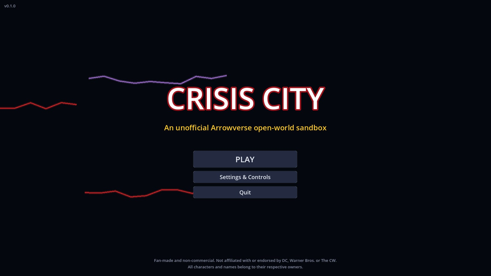
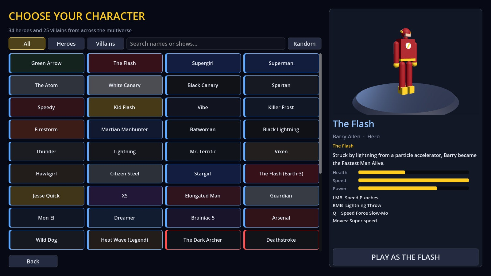
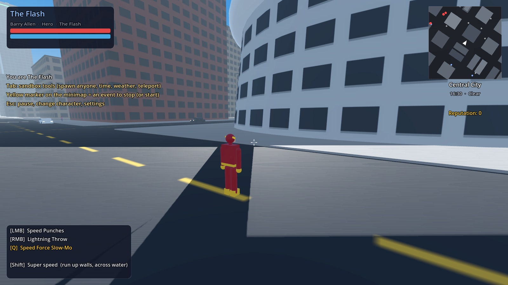
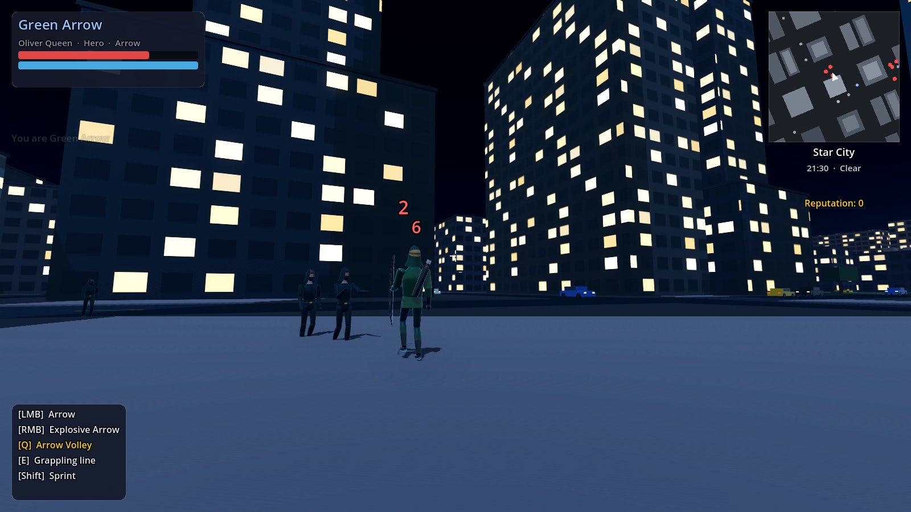
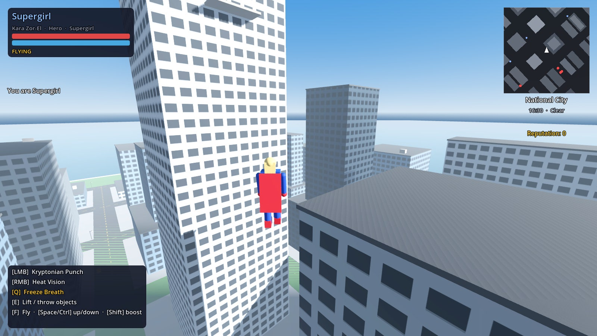
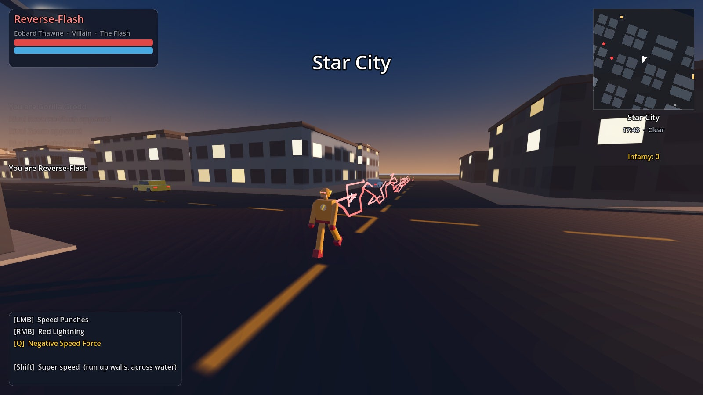
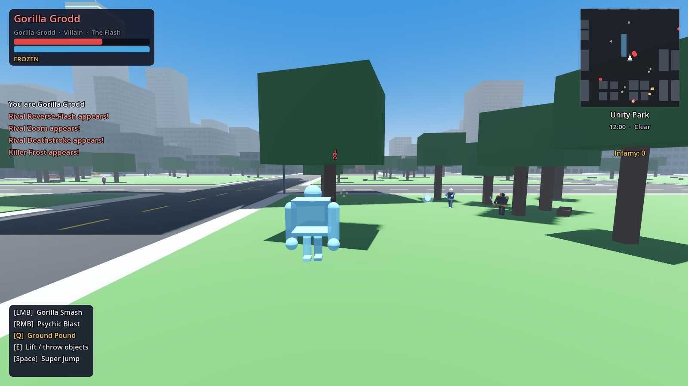
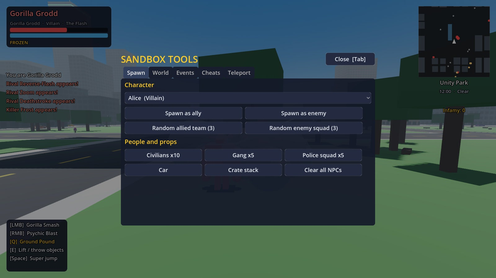
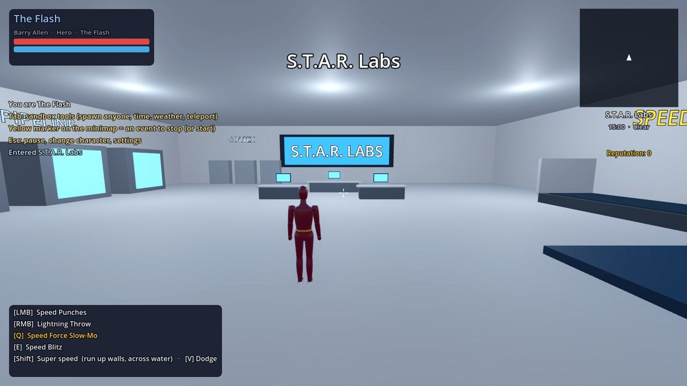
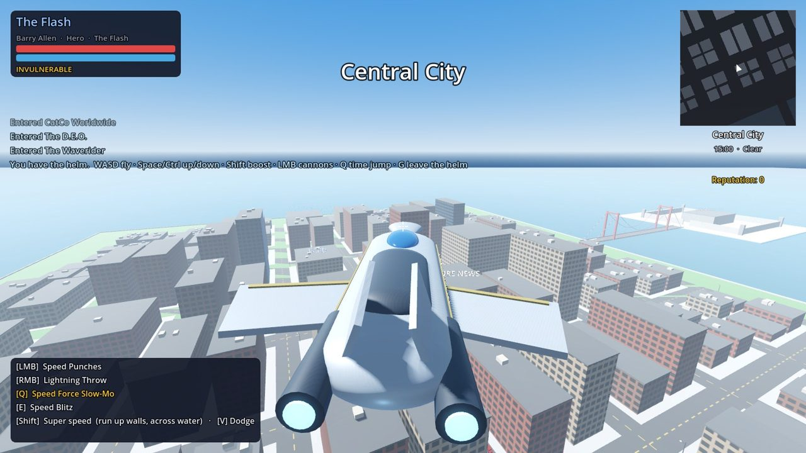
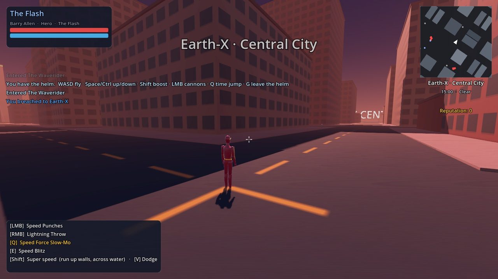
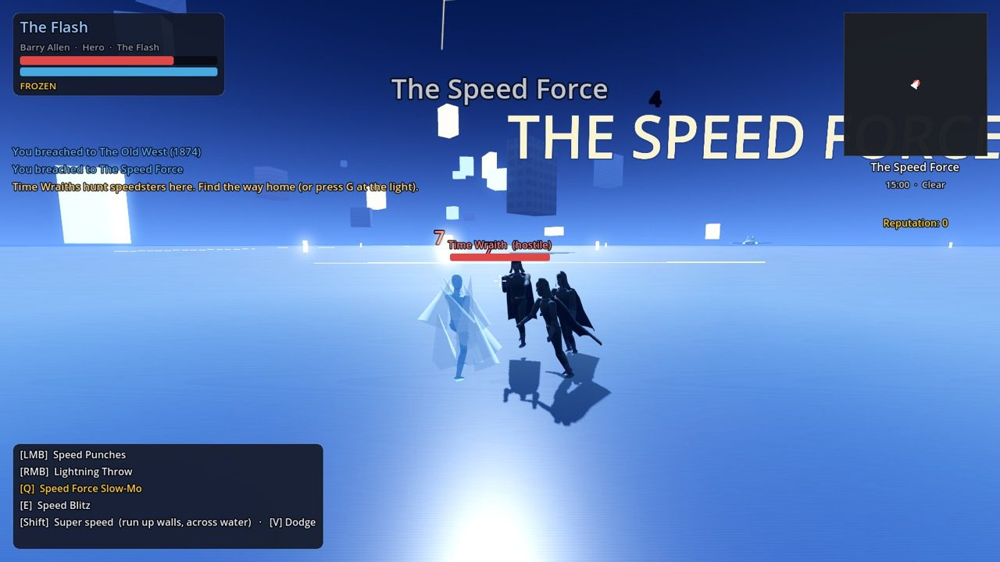
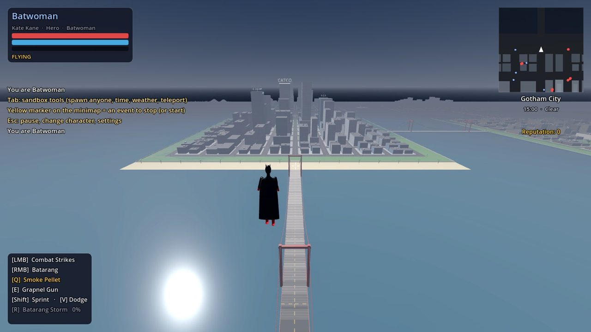
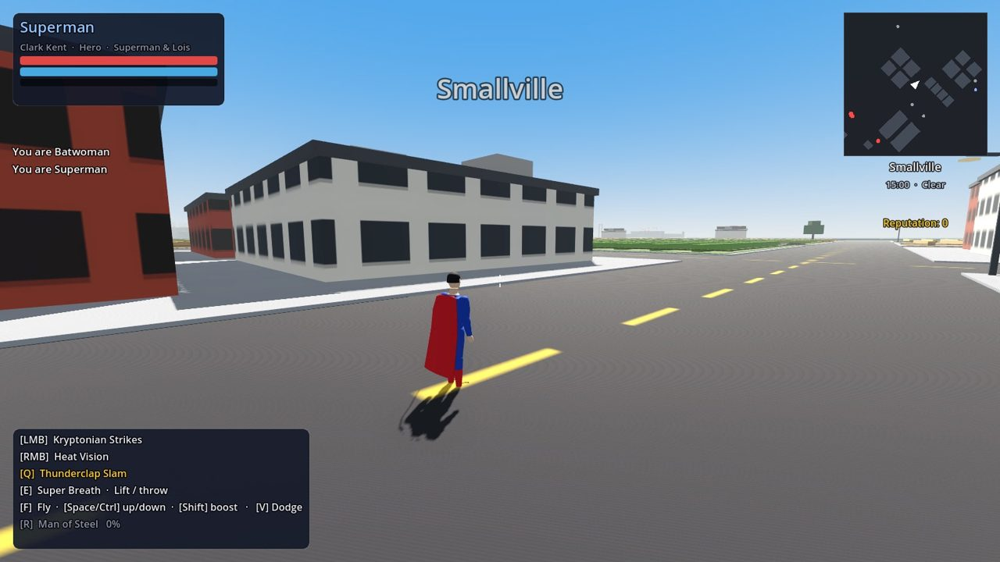
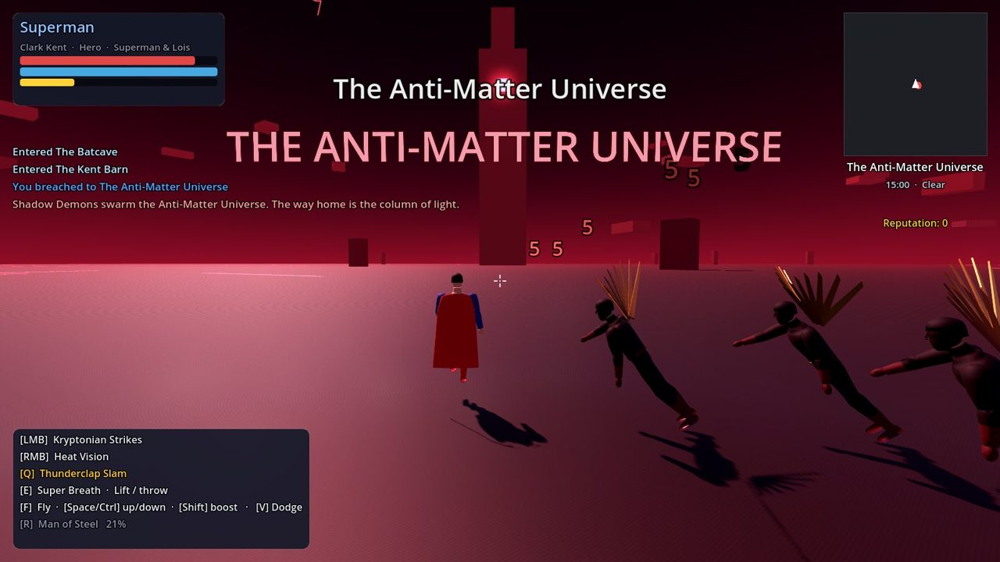

## Download and play

The *Test and build* GitHub Actions workflow builds Windows, macOS (universal: Apple Silicon and
Intel) and Linux versions on every push. Open the latest workflow run under **Actions** and
download the `CrisisCity-builds` artifact. Pushing a tag such as `v0.1.0` also attaches the three
zips to a GitHub Release.

| Platform | How to start |
| --- | --- |
| Windows | Unzip and run `CrisisCity.exe`. The build is unsigned, so SmartScreen may warn you: choose **More info → Run anyway**. |
| macOS | Unzip and move **Crisis City.app** to Applications. It is ad-hoc signed but not notarized, so the first time, right-click it and choose **Open**. On macOS 15, use **System Settings → Privacy & Security → Open Anyway**. |
| Linux | Unzip, then run `./CrisisCity.x86_64`. If the executable bit was lost, run `chmod +x CrisisCity.x86_64` first. |

Any GPU with OpenGL 3.3 (or the macOS equivalent) works. The game needs no internet connection.

## Run from source

1. Install [Godot 4.3 or newer](https://godotengine.org/download) (the standard build, not .NET).
2. Open Godot, click **Import**, and select this folder's `project.godot`.
3. Press **F5** (Run Project).

Or from a terminal: `godot --path .` to play, `godot --path . -e` to open the editor.

To build a release yourself, install Godot 4.3's export templates (**Editor → Manage Export
Templates**), then run, for example,
`godot --headless --path . --export-release "Windows" build/windows/CrisisCity.exe`.
The presets for `"Linux"`, `"Windows"` and `"macOS"` are in `export_presets.cfg`.

## Controls

| Action | Keyboard and mouse | Gamepad |
| --- | --- | --- |
| Move | W A S D | Left stick |
| Look / zoom | Mouse / mouse wheel | Right stick |
| Jump (flyers: climb) | Space | A |
| Sprint / super speed / flight boost | Shift | L3 |
| Primary attack | Left mouse | RT |
| Secondary attack (hold for beams) | Right mouse | LT |
| Special power | Q | Y |
| Grappling line, or lift and throw | E | RB |
| Take off / land (flyers) | F | LB |
| Descend while flying | Ctrl or C | B |
| Enter a door, use a console, drive a car, travel (speedsters at full speed, Vibe) | G | D-pad up |
| Ultimate (when charged) | R | R3 |
| Change in or out of costume | T | D-pad down |
| Dodge | V | X |
| Glide (caped characters, while falling) | Hold Space | Hold A |
| Block (tap just before a hit to parry) | B | D-pad right |
| Lock on to the nearest enemy | Z or middle mouse | D-pad left |
| Switch to a recruited ally | Y | |
| Whistle for Krypto (Kryptonians) | K | |
| Call the Waverider and take the helm / bail out of it | U | |
| Scan (hold) | X | |
| Map and fast travel | M | |
| Photo mode | P | |
| Emotes: wave, cheer, taunt, victory pose | 5 6 7 8 | |
| Extra powers | 1 2 3 | |
| Weapon wheel (hold) | H | |
| Sandbox tools | Tab | Back |
| Pause, change character, settings | Esc | Start |
| Hide HUD | F1 | |

## What's in the game

**The Waverider, rebuilt.**
- **Outside**, it looks like the show's ship: a long, tapering silver fuselage with a raised
  bridge and its window band, broad swept wings with gold leading edges, two huge engines burning
  blue-white at the stern, and canted tail fins.
- **Inside**, it's much bigger (40 x 72 m):
  - The bridge: the captain's chair, the crew's harness seats, the curved helm console and
    Gideon's holo table under a great window onto the Temporal Zone.
  - A corridor aft past Rip's study, the med bay, the Fabricator and galley, and a training room
    with the target drill.
  - The cargo bay, with the Jump Ship and the brig.
- **Flying it is easy:** press **U** anywhere outdoors and Gideon jumps the ship in overhead with
  you at the helm. W/S thrust, A/D turn, the mouse steers, Space/Ctrl climb and descend, Shift
  boosts, click fires the cannons and Q jumps through time. U again drops you out under the
  ship; G walks you back to the bridge. The HUD shows your speed and altitude.

**Breaches you can see.** Opening a breach (Vibe pressing G, the S.T.A.R. Labs Breach Room or
the sandbox) no longer teleports you on the spot. A swirling breach tears open a few steps ahead
of you, crackling at the edges and labelled with the Earth on the other side, and you walk
through it. On the far side you step out of a breach that seals behind you. If you don't use it,
it closes after 25 seconds.

**Ten new things to do.**
1. **Breach incursions:** a hostile breach opens in the street and keeps sending doppelgangers
   from other Earths through until you smash it shut.
2. **Falling civilians:** people tumble off a rooftop one after another. Catch them in mid-air,
   or be standing where they land.
3. **Meteor showers:** glowing rocks streak down with a warning ring where each will land.
   Smash them in the air before they hit the street.
4. **Runaway cars:** a car with no brakes ploughs through traffic. Get in front of it and dig
   in until it stops (strong heroes, fliers and speedsters stop it fastest), or jump in and drive.
5. **Most Wanted:** a named villain (or, for villains, a hero) roams the city with a price on
   their head. They show as a pink diamond on the minimap.
6. **A.R.G.U.S. supply drops:** crates parachute in under a green flare. Get there before the
   scavengers for full health and energy, ultimate charge and a rare weapon.
7. **Help requests:** someone shouts for help. Their cat is stuck up on a roof; fetch it down.
8. **Fans:** people recognise heroes in the street. Walk over and press G for a selfie.
9. **Krypto the Superdog:** Kryptonians press K to whistle for him. He flies at your side and
   bites the bad guys.
10. **Target drill:** every HQ armory has a drone drill. Smash as many as you can in 45 seconds
    and beat your best score.

**Characters.** 70 heroes and 60 villains, each with their own costume, stats, two attacks, a
special power, often a utility power (E), and a signature **ultimate** (R):

- **Heroes:** Green Arrow, The Flash, Supergirl, Superman, The Atom, White Canary, Black Canary,
  Spartan, Speedy, Kid Flash, Vibe, Killer Frost, Firestorm, Martian Manhunter, Batwoman,
  Black Lightning, Thunder, Lightning, Mr. Terrific, Vixen, Hawkgirl, Citizen Steel, Stargirl,
  Jay Garrick, Jesse Quick, XS, Elongated Man, Guardian, Mon-El, Dreamer, Brainiac 5, Arsenal,
  Wild Dog, Heat Wave (Legend), Constantine, Zari, Nyssa al Ghul, Hawkman, the Flash of Earth-90,
  the Spectre, Jordan Kent, Rip Hunter, Amaya (Vixen of 1942), Ava Sharpe, Mona Wu (Wolfie),
  Charlie, Behrad Tarazi, Astra Logue, Spooner, Wildcat, Hourman, Dr. Mid-Nite, Starman,
  Doctor Fate, Green Lantern (Alan Scott), Jade, Obsidian, S.T.R.I.P.E., Johnny Thunder,
  Huntress, Mia Smoak, Ragman, Sentinel, Steel (John Henry Irons), Ryan Wilder's Batwoman,
  Batwing, Grace Choi, the Ray, the Monitor and Harbinger.
- **Villains:** Malcolm Merlyn, Deathstroke, Prometheus, Damien Darhk, Reverse-Flash, Zoom,
  Savitar, The Thinker, Captain Cold, Heat Wave, Weather Wizard, Reign, Lex Luthor, Ra's al Ghul,
  Cicada, Gorilla Grodd, Vandal Savage, Black Siren, Ricardo Diaz, Alice, Captain Boomerang,
  the Anti-Monitor, Overgirl, Dark Arrow, Tobias Whale, King Shark, Mirror Master, Livewire,
  Metallo, Godspeed, Red Death, and from the Injustice Society: Icicle, Brainwave, Solomon Grundy,
  the Shade, Sportsmaster, Tigress, Eclipso, Dragon King and Cindy Burman. Also Bronze Tiger,
  Count Vertigo, Deadshot, Talia al Ghul, Golden Glider, Pied Piper, the Trickster, the Black
  Flash, Atom Smasher, Bizarro, Doomsday, Tal-Rho, General Astra, Cyborg Superman, Poison Ivy,
  Hush, Black Mask, Mallus, Neron and Painkiller.

**Your own story.** Every character has a three-part personal mission line (shown in blue on the
HUD and minimap):
- **Hand-written stories for the main characters.** Barry fights Weather Wizard, runs into the
  Speed Force, then takes on the Man in Yellow. Kara flies to Argo City and fights Reign. Oliver
  goes back to Lian Yu. Kate glides over Gotham to face Alice. Stargirl rebuilds the JSA.
- **Everyone else** gets missions built from their home city, their team and their nemesis.

**Space and Argo City.**
- Fly straight up: past 450 m the sky turns black, and at 700 m you leave the atmosphere.
- Argo City, the last Kryptonian city, is domed and drifting in orbit. Earth turns below it, the
  Moon hangs off to one side, and its streets are full of Kryptonians.
- Dive off the edge to fall back to Earth. The Waverider can make the trip too.

**The Speed Force, as the show draws it.** A dark blue void crackling with blue and gold
lightning. A lightning road leads into the turning time vortex, and pieces of Barry's life drift
past: the Allen house, S.T.A.R. Labs, Jitters and the particle accelerator. The Speed Force waits
at its heart as Nora Allen; talk to it to charge up a speedster.

**Bigger cities.** Each city is now 12 x 12 blocks, and they sit 2 km apart, joined by long
bridges.

**Gliding.** Batwoman, Ryan Wilder, Dr. Mid-Nite and Red Death glide on their capes. Hold jump
while falling to sail forward, and hold descend to dive.

**Powers look like moves.**
- Every special has its own cast animation: a ground pound, a spin, a palm thrust, a summoning, a
  coiled charge-up, a raised fist for Green Lantern's ring, a stomp or a power-up.
- Each comes with its own effect: shockwaves, glowing ground cracks, columns of light, impact
  lines or energy streaming into the hands.
- Ultimates open with the character powering up in a pillar of light.
- Combo finishers burst with impact lines.

**A new HUD.**
- A player badge in your colours, ringed with your ultimate charge.
- Health shown in numbers.
- An ability bar along the bottom with a tile for every power. Each tile shows its key, a
  cooldown sweep and a glow when it's ready, and dims when you can't afford it.
- Notifications slide in as toasts with a coloured edge.
- Objectives sit in their own panel.
- The minimap has a frame and a compass.
- Menus have glassier panels, and buttons get an accent edge on hover.

**Weapon wheel and extra powers.**
- Hold **H** for the weapon wheel and point at a weapon or power. Let go to equip it.
- Time slows while the wheel is open. The mouse wheel (or Q / E) flips between rings: primary,
  secondary, power (Q), utility (E) and emotes.
- Every character also has **three extra powers on keys 1, 2 and 3**. These come from their
  alternate kit and archetype: a speedster gets a speed vortex, a sound barrier and time
  remnants; a mystic gets a life drain, a hex of sleep and a teleport. Enemies use them too.
- Emotes moved to keys 5 to 8 (and the wheel).

**Bigger, busier cities.**
- Each city is now 14 x 14 blocks.
- New kinds of block: plazas with fountains (toss a coin for luck), parking lots full of cars,
  building sites with a steel frame and a tower crane to climb, basketball courts, and gas
  stations.
- Street things you can use:
  - **Subway stations:** ride to any other station.
  - **Hot dog carts:** heal you.
  - **Vending machines:** refill your energy.
  - **ATMs:** villains can crack them, and the police come running.
  - **Phone booths:** call a teammate to join you.
  - **Basketball hoops** you can shoot at.
- **The map (M)** now shows building footprints, entrances, subway stations, street stops and
  any Crisis Fragments still to find. Zoom with the mouse wheel and drag to pan. The minimap
  shows subways and street stops too.

**Better looking.**
- **Vehicles:** real body shapes for sedans, hatchbacks, SUVs, vans, sports cars and pickups, plus
  taxis with roof signs and checker stripes and police cruisers with flashing light bars. Each
  has a glass greenhouse with pillars, wheels with rims, wheel arches, bumpers, a grille,
  mirrors, door seams, plates and working lights. Motorcycles have a frame, tank, forks, spoked
  wheels and an exhaust.
- **Buildings:** windows have frames, two panes of reflective glass, sills and floor bands, and
  which windows are lit varies from block to block. Street-level shopfronts have awnings and lit
  signs. There are stone ledges between floors, roof parapets, AC units, stair huts, antennas
  and wooden water tanks.
- **People:**
  - Bigger, readable eyes with pupils and highlights, lash lines, heavier brows, and ears.
  - Hair with a fringe, crown tufts, long strands and curls instead of a helmet.
  - Slimmer shoulders.
  - Civilians now wear hoodies, ties with office clothes, backpacks, beanies, caps, glasses and
    sneakers with white soles. Thugs get beanies and caps.

**Loadouts.**
- Pick each character's primary, secondary, special and utility from character select ("LOADOUT")
  or from the armory in any HQ (S.T.A.R. Labs, the Bunker, the Batcave, the D.E.O., the JSA
  brownstone, the Waverider, L-Corp, Garfield High).
- Every slot lists the character's signature power first, then their alternate kit, then powers
  that fit what they are (speedster, Kryptonian, archer, mystic, elemental, tech, brawler).
- The armory's weapons are last: pistols, a rifle, a shotgun, a bo staff, a katana, escrima
  sticks, Hawkgirl's mace, a bow, a crossbow, the cold gun and the heat gun, plus batarangs,
  grenades and rockets. They show up in the character's hands.

**Telekinesis.** Canon telekinetics (Gorilla Grodd, the Thinker, Damien Darhk, Brainwave,
Doctor Fate, the Spectre, the Monitor, Astra Logue, Mallus, Martian Manhunter, Eclipso, Neron,
Dreamer, Harbinger) press E to lift whatever they aim at. That can be a car, a bench or a
person. Click to throw it.

**Walk-in buildings.** No more teleporting through doors. These all have front entrances you
walk through:
- S.T.A.R. Labs, Verdant and the Bunker, Jitters, CatCo, the D.E.O., the Batcave, the Kent Barn
  and the JSA brownstone.
- New: Queen Consolidated's lobby, the CCPD with Barry's crime lab, L-Corp, Garfield High,
  Arkham Asylum, and the Iron Heights cell block (cross the bridge, go through the yard gate, and
  the door is on the north face).

**Ten more features.**
1. **Weapon pickups:** knocked-out thugs and police sometimes drop a pistol, rifle, shotgun or
   katana. Walk over it to use it until the ammo runs out.
2. **Superhero landings:** drop from a height and you land on one knee, the street cracking
   around you, knocking back anyone nearby.
3. **Boss rage:** at half health a boss powers up, gets faster and calls in backup.
4. **Street muggings:** small crimes between the big events. Stop the mugger within 45 seconds.
5. **Weather powers:** Weather Wizard's storm, lightning ultimates and Absolute Zero change the
   sky for a while.
6. **Med bays** in the HQs restore your health and energy, and your allies' too.
7. **Armories** in the HQs open the loadout screen.
8. **Arrests:** as a hero, press G on a knocked-out villain to carry them, then lock them up in an
   Iron Heights or Arkham cell, or the CCPD holding cell.
9. **Jailbreaks:** as a villain, open the cells at Iron Heights and Arkham and the inmates join
   you.
10. **Rooftop elevators:** Queen Consolidated and L-Corp have lobby elevators to the roof, and
    back down again.

**Teams.**
- Every character belongs to a team: Team Flash, Team Arrow, the Legends, the Justice Society,
  the Injustice Society, the Legion of Doom, the Rogues and more. Filter by team in character
  select.
- **Team-up bonus:** fight next to a recruited teammate and your attacks hit 20% harder.
- **Team events:** a whole villain team hits the city at once.
- **Nemesis:** your archenemy (the Reverse-Flash for the Flash, Icicle for Stargirl...) hunts
  you down as a boss.
- **Mastery:** every character levels up separately (1-10). Each level adds health and power.
- **JSA Headquarters:** the Justice Society's brownstone in Smallville. Walk in, see the Golden
  Age suits and call three JSA members to the round table.
- New powers: Green Lantern constructs, Miraclo, the Shade's darkness, Doctor Fate's ankh,
  Johnny Thunder's Thunderbolt and Atom Smasher's growth.

**Every character plays differently.** Kits mix 60+ mechanics: chain lightning that jumps
between enemies (XS, Zoom, Godspeed, Livewire), momentum punches that hit harder the faster you
run (Kid Flash, the Flash of Earth-90), Reverse-Flash's phasing strike that goes straight through
shields, Green Arrow's trick quiver (net, flash and freeze arrows) and Speedy's triple shot,
Arsenal's tracer arrows, Nyssa's poison, Killer Frost's ice spikes, Elongated Man's long arm,
Kid Flash's sound-barrier dash, Godspeed's clone army and Savitar's time remnants, the Martian
Manhunter shapeshifting into a passer-by, Mirror Master, Vibe and Constantine trapping enemies
in mirrors, breaches or Hell, Heat Wave's napalm, Metallo's kryptonite field (deadly to
Kryptonians), Stargirl's gravity well, Batwoman's bat swarm, Ra's al Ghul's Lazarus Pit,
Dreamer and Alice putting crowds to sleep, and Black Lightning's overload.

**Every character moves differently.** Each has their own idle mannerism (arms crossed, hands on
hips, a boxer's bounce, a bow at the ready, hovering, hunched...), their own gait (a sprinter, a
heavy stomp, a prowl, a swagger, a ninja run, a glide...), and speedsters and fliers have their
own sprint and flight poses: Superman's fist forward, Supergirl's arms at her sides, the Martian
Manhunter's crossed arms, Hawkgirl's flapping wings, Stargirl riding her staff, Livewire's
corkscrew, Jordan Kent's wobbly first flights, Zoom's arms-back sprint and Jay Garrick's upright run.

**Ultimates.** Fighting fills a gold meter; at 100% press R. Speedsters blitz every enemy in
range, Kryptonians go invulnerable and sweep heat vision across the crowd, Green Arrow calls in
Team Arrow and White Canary the Legends, Black Lightning and Livewire call down lightning storms,
Killer Frost freezes everything solid and shatters it, Black Canary's cry hits in every direction,
Vibe drops enemies through breaches, the Atom and the Martian Manhunter grow giant, Grodd lifts
the whole street with his mind, Deathstroke dashes through everyone, and the Anti-Monitor erases
the area in a wave of anti-matter. NPCs use theirs too.

**The Crisis on Infinite Earths campaign.** Seven saved chapters: S.T.A.R. Labs, Zoom on Earth-2,
Overgirl and Dark Arrow on Earth-X, the Time Wraiths of the Speed Force, the Shadow Demons of a
dying Earth-90, the Anti-Monitor himself, and home to Earth-Prime. The HUD tracks the objective
and the minimap points the way. Restart it from the pause menu.

**Secret identities.** Press T to change in or out of costume. Everyone with a secret identity has
their own transformation: the Flash's suit shoots out of his ring in a spiral of lightning,
Superman rips open his shirt (and Clark keeps his glasses), Killer Frost lets the frost spread
until her hair turns white, Vibe slips on his goggles, Black Lightning calls down a bolt, Stargirl
summons the Cosmic Staff, Green Arrow pulls up his hood, the Atom's exosuit assembles plate by
plate, and Reverse-Flash drops Harrison Wells' face. In civilian clothes you're Barry, Kara,
Oliver or Cisco: just punches and kicks, no powers, flight or super speed, and enemies don't
recognise you. Change somewhere nobody's watching and the police lose your trail.

**Ranks.** Every point you earn counts toward a lifetime rank (1 to 20, from Rookie to Living
Legend, or Thug to God of Evil). Each rank adds 3% health and power to every character.

**Races.** Start a street race or a sky race from the Tab menu's Events tab: hit eight rings
before the clock runs out. Speedsters get a tighter clock.

**More events.** Dominator invasions drop alien soldiers from the sky, and inmates break out of
Iron Heights.

**Drive.** Press G next to any parked car, or carjack one out of traffic (heroes take heat for
it). Shift for nitro, Space for the handbrake.

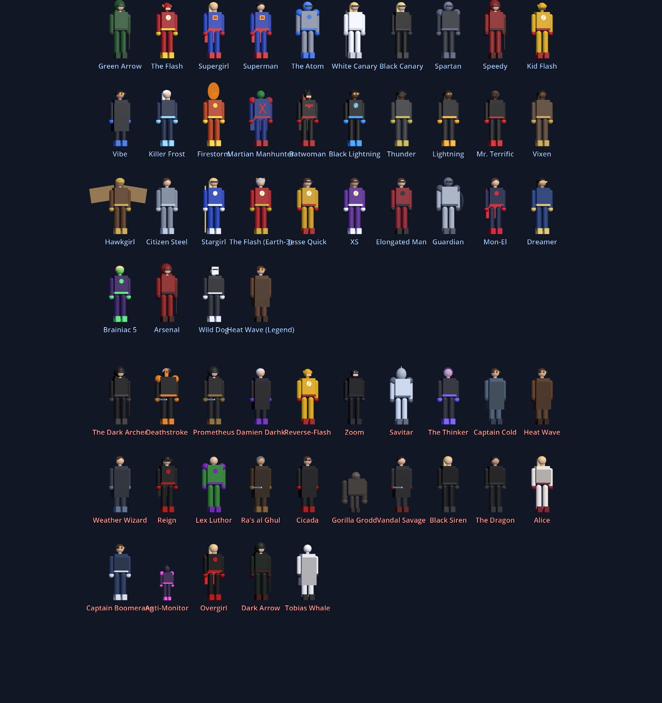

**How they move.** Speedsters sprint at 60+ m/s, run up walls and across the bay, leaving
lightning trails. Kryptonians, Martians, Firestorm, the Atom and others fly. Archers and
vigilantes swing on grappling lines. Thunder, Vixen, Citizen Steel and Grodd super-jump. Anyone
with super strength can pick up crates and cars and throw them.

**Powers.** Arrows and explosive arrows, thrown blades and boomerangs, energy bolts, heat vision
and freeze beams, sonic cries, chain lightning, guns, dashes. Specials include Speed Force
slow motion, speed vortexes, ground slams, smoke bombs, ice/fire/lightning novas, shrinking,
invisibility, invulnerability, breach teleports and Darhk's life drain. Fire burns, ice freezes
and lightning stuns.

**The map.** Four city islands, each about 740 m across with its own architecture, sit in a bay
joined by suspension bridges:
- **Star City:** steel-and-glass towers, Queen Consolidated, Verdant and SCPD, plus the rundown
  Glades and the docks.
- **Central City:** brick and sandstone, S.T.A.R. Labs, CCPD, Jitters and Picture News.
- **National City:** white stone and blue glass, CatCo, the D.E.O., L-Corp and a palm-lined beach.
- **Freeland:** low-rise neighbourhoods, Garfield High and the clinic.
- **Gotham City:** soot-black gothic towers with spires and gargoyles under a permanent overcast,
  Wayne Tower (the Batcave is beneath it), GCPD with the Bat-Signal lit, Arkham Asylum and Crows
  Security.
- **Smallville:** farmland, Main Street, the water tower, Smallville High and the Kent Farm.

Offshore are Iron Heights prison (with its own bridge) and Lian Yu, a jungle island with a plane
wreck. There's a day/night cycle with lit windows and streetlights, plus rain, storms and fog.

**Go inside: just walk in.** S.T.A.R. Labs, the Arrow Bunker under Verdant, Jitters, CatCo,
the D.E.O., the Batcave under Wayne Tower and the Kent Barn are built inside their real buildings,
behind a lit ENTRANCE on the street. Only the Waverider (bigger on the inside) is boarded with G
at its ramp.
- **S.T.A.R. Labs:** the Cortex, the Pipeline, a Speed Lab treadmill that takes speedsters into the
  Speed Force, and Cisco's Breach Room.
- **The Arrow Bunker** under Verdant: the salmon ladder, and the team's suits on display. Suit up
  to switch character.
- **Jitters, CatCo** (step out onto the balcony) and **the D.E.O.**
- **The Batcave** under Wayne Tower and **the Kent Barn**, with the ship that brought Kal-El.
- **The Waverider:** board it from its landing pad off the Star City bridge. Ask Gideon to plot a
  course, or take the helm.

**Fly the Waverider.** Take the helm to fly anywhere: it steers where you look, and you can boost,
climb and fire its cannons. Press Q to jump through time to 1942, the Old West, a ruined 2046 or
neon 3030.

**The multiverse.** Speedsters running flat out can press G to vibrate into the Speed Force,
where Time Wraiths hunt them, or onto another Earth. Vibe can open a breach anywhere, and so can
the S.T.A.R. Labs Breach Room. Earth-2, Earth-3, Earth-X, Earth-38, Earth-19, Earth-90 (being
erased by anti-matter), Earth-99, Earth-167 and Earth-Prime each have their own skyline, colours,
sky and locals: Zoom waits on Earth-2, the Reich patrols Earth-X. You can also reach Argo City,
the Anti-Matter Universe (Shadow Demons and the Anti-Monitor's tower), and, by Waverider,
Vanishing Point, the Time Bureau's station at the end of time.

**A living world.** Civilians walk the sidewalks and flee from fights. Traffic drives the
streets until you hit it. Police patrol, and gangs (the Ghosts, Rogues, Cadmus and the 100) stake
out corners, with more of them at night.

**Heroes and villains play differently.**
- As a **hero**, you earn *Reputation* by stopping robberies, gang wars, super-villain attacks
  and breaches. Hurting civilians or police raises your *heat*: at 2 the police turn on you,
  and at 4 other heroes come after you.
- As a **villain**, you earn *Infamy* by breaking up police raids, taking down hero patrols and
  pulling off armored-truck heists. Your heat rises with every crime, and at 3 heroes start
  hunting you.

**Combat.**
- A **style meter** ranks your fighting from D to SSS. Mixing up attacks ranks it faster, and
  getting hit knocks it down. Higher ranks multiply your score.
- **Block and parry:** blocking soaks most damage, and a well-timed block stuns the attacker.
- **Lock-on** keeps the camera on one enemy.
- **Dive slams** come from attacking in mid-fall.
- **Takedowns** finish off stunned enemies.
- Bosses get a health bar and a slow-motion **final blow**.

**The city.**
- Benches, hydrants (which gush when broken), mailboxes, dumpsters and newspaper boxes can all be
  thrown.
- Motorcycles, including the Arrowbike outside Verdant, can be ridden.
- A **news ticker** reports what you do, and news helicopters circle when the heat is up.
- Weather now includes snow, and some Earths have their own weather.
- There is a difficulty setting.

**Exploration.**
- 40 **Crisis Fragments** are hidden on rooftops and in far corners. Every five unlock one of
  18 alternate suits, which you pick in character select.
- The **map** (M) sets waypoints and fast-travels to landmarks you've visited.
- **Scan** (hold X) highlights enemies and fragments and identifies characters.
- **Photo mode** (P) has filters.

**Progression.**
- 24 achievements, and an Achievements & Stats page in the pause menu.
- Three rotating challenges with rewards.

**Activities.**
- **Building fires:** carry the trapped civilians (G) to the ambulance and put out the flames with
  ice, wind or super breath.
- **Getaway chases:** wreck the car, then fight the robbers.
- **Survival waves**, with a boss every fifth wave, from the sandbox or the S.T.A.R. Labs
  training room.
- **Recruit** up to three nearby heroes (G), then switch between them (Y).
- Civilians cheer heroes, take photos of them, and run from villains.

**Presentation.** Procedural music shifts between calm and combat loops, and every character has
emotes and a catchphrase taunt.

**Sandbox tools (Tab).**
- Spawn any character as an ally who follows you or as an enemy (an "evil Supergirl" works).
- Spawn random teams, crowds, gangs, police squads, cars and crates.
- Set the time of day, freeze time, change the weather and adjust gravity.
- Start any event.
- Cheats: god mode, infinite energy, one-hit KOs and no heat.
- Teleport to any landmark, or inside any building.
- Multiverse: jump straight to any Earth, era or the Speed Force.

## Project layout

```
data/roster.json        every character: stats, movement, attacks, special, costume
scripts/core/           Game (roster, input map, settings, factions, heat) and Sfx autoloads
scripts/actors/         Actor body, procedural CharacterModel, player/AI brains, camera
scripts/combat/         Abilities, projectiles and visual effects
scripts/world/          City generator, day/night and weather, population, events, props
scripts/ui/             title, character select, HUD, minimap, pause and sandbox menus
shaders/facade.gdshader building windows that light up at night
tests/                  headless test suite
tools/shots.gd          renders the screenshots in docs/
```

All art, models, textures and sound effects are generated in code at runtime, so the repository
contains no third-party assets.

### Adding a character

Add an entry to `data/roster.json`. Copy an existing character and change its fields:

- `movement`: one of `run`, `speed`, `flight`, `grapple`, `superjump`.
- `primary` / `secondary`: an attack `kind` (`melee`, `arrow`, `explosive_arrow`, `throw`,
  `bolt`, `beam`, `sonic`, `lightning`, `gun`, `dash`) with optional `damage`, `cooldown`,
  `range`, `speed`, `color` and `element` (`fire`, `ice`, `shock`).
- `special`: a `kind` from `scripts/combat/abilities.gd`.
- `look`: suit, accent, skin and hair colours, plus costume `extras` (cape, hood, cowl, bow,
  wings, helmet and more; see `scripts/actors/character_model.gd`).

The test suite checks every entry.

## Tests

```sh
godot --headless --path . res://tests/test_runner.tscn
```

The suite validates the roster and city generation. It plays every character with every
ability, runs a 72-character AI brawl, and starts every event type. It also simulates real
input: sprinting, walking, jumping, flying, heat vision, super-jumping, grappling, shooting and
slow-mo. Finally it checks combat, factions, heat, props, traffic and the menus. CI runs it on
every push before exporting the builds.

## Disclaimer

Crisis City is a non-commercial fan project. It is not affiliated with, endorsed by or
sponsored by DC, Warner Bros. Discovery or The CW. All characters, names and related marks
belong to their respective owners.
